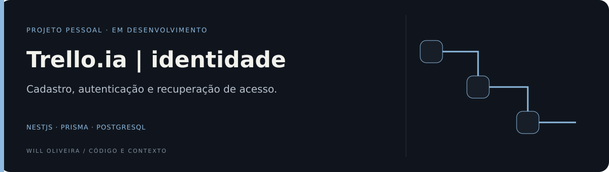

<p align="center">
  
</p>

# Trello.ia · Backend

API de autenticação e persistência para uma aplicação de organização de tarefas.

**NestJS · TypeScript · Prisma · PostgreSQL**

[Frontend](https://github.com/Will-Ifes/trello-ia-frontend) · [Código](src) · [Execução](#executar)

## Explore o diferencial

| Ponto de entrada | O que observar |
| --- | --- |
| [Regras além do endpoint](src/auth/auth.service.ts) | O service reúne hash, autenticação e recuperação de senha. |
| [Teste do domínio](src/auth/auth.service.spec.ts) | Os testes do service documentam cenários do fluxo de autenticação. |

## Destaques

- Cadastro e login de usuários com senha armazenada em hash.
- Autenticação JWT com cookie HTTP-only.
- Solicitação de recuperação e redefinição de senha por e-mail.
- Schema e migrações de banco com Prisma.
- Testes para os fluxos de autenticação.
- Arquivos de Docker para ambientes de desenvolvimento e produção.

> **Em desenvolvimento:** quadros, listas, cards e IA ainda fazem parte do roadmap.

<details>
<summary><strong>Arquitetura e código</strong></summary>

### Decisões

A API começa pelo domínio de identidade: cadastro, login, consulta do usuário e recuperação de senha. O NestJS separa controller, service, estratégia JWT e acesso ao banco.

- **Prisma:** schema e migrações tornam as relações de dados explícitas.
- **Hash de senha:** o service usa bcryptjs e remove a senha das respostas preparadas para o cliente.
- **JWT:** autenticação de rotas e token temporário de recuperação.
- **Cookie HTTP-only:** o controller configura o cookie de login; as ações do frontend fazem a integração.

### Caminhos de leitura

- [Controller e contrato HTTP](src/auth/auth.controller.ts).
- [Hash, autenticação e recuperação](src/auth/auth.service.ts).
- [Configuração obrigatória do segredo](src/config/jwt-secret.ts).
- [Schema](prisma/schema.prisma).
- [Testes do service](src/auth/auth.service.spec.ts).
- [Teste de login de ponta a ponta](test/auth/login.e2e-spec.ts).

### Endpoints

| Método | Rota | Finalidade |
| --- | --- | --- |
| POST | `/auth/register` | Cadastro |
| POST | `/auth/login` | Login e cookie |
| POST | `/auth/forgot-password` | Solicitar link por e-mail |
| POST | `/auth/reset-password` | Redefinir senha com token |
| POST | `/auth/logout` | Limpar cookie |
| GET | `/auth/me` | Consultar identidade autenticada |

### Organização

```text
src/
├── auth/          # Cadastro, login, recuperação e JWT
├── config/        # Configuração de ambiente
├── users/         # Estrutura inicial do módulo de usuários
├── app.module.ts  # Módulo principal
└── main.ts        # Inicialização da API
prisma/
├── migrations/    # Histórico do esquema do banco
└── schema.prisma  # Modelos de dados
test/              # Testes de integração
```

### Tecnologias

- **NestJS 11 e TypeScript** · estrutura da API.
- **Prisma ORM + PostgreSQL** · modelo de dados e migrações.
- **JWT, Passport e bcryptjs** · autenticação e proteção de senha.
- **class-validator** · declara regras nos DTOs; a aplicação global dessas regras ainda precisa de revisão.
- **Jest + Supertest** · testes unitários e de integração.
- **Docker, ESLint e Prettier** · ambiente de desenvolvimento e qualidade de código.

</details>

<a id="executar"></a>

<details>
<summary><strong>Executar, testar e configurar</strong></summary>

Requer Node.js, pnpm e PostgreSQL. Copie `.env.example` para `.env` e configure seus próprios valores de `DATABASE_URL`, `JWT_SECRET` e `FRONTEND_URL`. Para recuperação de senha, configure também `EMAIL_USER` e `EMAIL_PASS`.

```bash
cp .env.example .env
pnpm install
pnpm prisma generate
pnpm prisma migrate dev
pnpm start:dev
```

Os arquivos `docker-compose.dev.yml` e `docker-compose.prod.yml` estão disponíveis para quem preferir rodar os serviços em contêineres. Eles exigem as variáveis locais e a rede externa `trelloia-shared`.

### Scripts disponíveis

| Comando | Finalidade |
| --- | --- |
| `pnpm start:dev` | Inicia a API com recarregamento |
| `pnpm build` | Compila a aplicação |
| `pnpm start:prod` | Executa a build compilada |
| `pnpm prisma generate` | Gera o cliente Prisma |
| `pnpm prisma migrate dev` | Aplica migrações no banco local |
| `pnpm test` | Executa testes unitários |
| `pnpm test:e2e` | Executa testes de integração |
| `pnpm test:cov` | Gera cobertura dos testes |

### Ambiente

O arquivo [`.env.example`](.env.example) contém apenas valores de exemplo. Crie segredos novos para seu ambiente e mantenha `.env` e `.env.prod` fora do versionamento. A aplicação exige `JWT_SECRET` configurado; não utiliza uma chave padrão no código.

### Pontos de atenção

Os DTOs possuem regras de validação, mas a inicialização atual não registra um `ValidationPipe` global; a aplicação dessas regras deve ser revisada. O token de recuperação é verificado por JWT e expiração; invalidação após uso e proteção contra abuso são evoluções pendentes. O cookie usa `secure: true`, portanto o transporte local precisa ser compatível.

Os testes estão versionados; isso não comprova cobertura completa ou aprovação atual. Configure banco e e-mail de teste próprios. Quadros, listas, cards e IA ainda não são recursos entregues.

</details>

<details>
<summary><strong>Documentação, evolução e créditos</strong></summary>

 

### Evolução

- CRUD de quadros, listas e cards.
- Regras de colaboração e organização de tarefas.
- Recursos de IA para sugestões e automações.

### Colaboração e licença

Sugestões podem ser enviadas por issue ou pull request. O projeto ainda não possui licença definida; consulte o autor antes de reutilizar o código fora das permissões padrão do GitHub.

Desenvolvido por **Wildemberg de Jesus Oliveira (Will)** · [LinkedIn](https://www.linkedin.com/in/wildemberg-de-jesus-oliveira/)  
Projeto iniciado em 2025 em outra conta GitHub e reunido neste perfil em uma cópia revisada.

</details>
