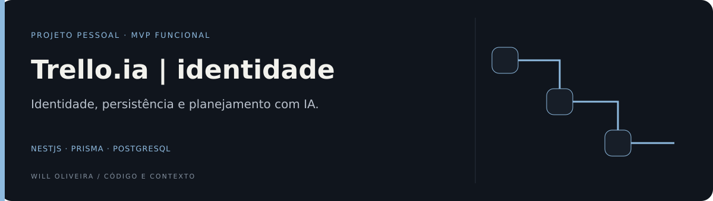

<p align="center">
  
</p>

# Trello.ia · identidade e organização

A API que dá continuidade aos projetos: autentica usuários, protege o acesso aos quadros e mantém listas e cartões no PostgreSQL. A IA transforma uma ideia em um plano inicial, com o provedor configurado no servidor.

**NestJS 11 · TypeScript · Prisma 6 · PostgreSQL**

[](https://github.com/Will-Ifes/trello-ia-backend/actions/workflows/ci.yml)

[Frontend](https://github.com/Will-Ifes/trello-ia-frontend) · [Código](src) · [Execução detalhada](docs/setup.md) · [Publicação](docs/deploy.md)

## O que a API entrega

- Cadastro, login com cookie HTTP-only e identidade autenticada.
- Recuperação de senha por e-mail com token aleatório, hash persistido, expiração e uso único.
- Quadros, listas e cartões vinculados ao proprietário.
- Movimentação entre listas do mesmo quadro, prazo e conclusão de tarefas.
- Geração de quadros por OpenRouter, com validação da resposta e gravação atômica.
- Validação global de entradas, limites de requisições e logs sem corpo de senhas.

## Da base inicial ao MVP

| Antes                                        | Agora                                               |
| -------------------------------------------- | --------------------------------------------------- |
| Apenas autenticação parcial                  | Identidade e Kanban integrados                      |
| Nenhum modelo de quadro, lista ou cartão     | Relações e migração de banco versionadas            |
| Regras de DTO sem aplicação global           | ValidationPipe com rejeição de campos desconhecidos |
| Recuperação aceitava JWT sem consumo         | Token opaco com hash, expiração e consumo único     |
| Cookie exigia HTTPS também no ambiente local | Configuração compatível com cada ambiente           |
| Dependências antigas e testes parciais       | Dependências corrigidas, testes com banco real e CI |

## Arquitetura

| Caminho                                          | Responsabilidade                                |
| ------------------------------------------------ | ----------------------------------------------- |
| [Autenticação](src/auth)                         | Cadastro, senha, JWT e recuperação              |
| [Quadros](src/boards)                            | Propriedade, operações e geração por IA         |
| [Schema Prisma](prisma/schema.prisma)            | Usuário, recuperação, quadros, listas e cartões |
| [Configuração HTTP](src/config/configure-app.ts) | Validação, cookies, CORS e logs                 |
| [Integração](test/kanban.e2e-spec.ts)            | Persistência e isolamento entre usuários        |

O frontend Next.js encaminha as chamadas do navegador para a API. A autorização é aplicada também no servidor: conhecer o identificador de outro quadro não concede acesso.

## Executar localmente

Requer **Node.js 24** e **pnpm 11.25.0**.

```sh
pnpm install --frozen-lockfile
pnpm db:local
```

Deixe o PostgreSQL local rodando e, em outro terminal:

```sh
pnpm db:generate
pnpm db:migrate
pnpm start:dev
```

A API atende em [localhost:3000](http://localhost:3000). O banco de desenvolvimento usa a porta 55432 e arquivos locais ignorados pelo Git. O script cria os ambientes apenas se estiverem ausentes, preserva os dados e separa a base de testes.

<details>
<summary><strong>Testes, configuração e produção</strong></summary>

```sh
pnpm lint
pnpm build
pnpm test --runInBand
pnpm test:e2e
pnpm audit --prod
```

Foram aprovados 30 testes unitários e 14 de integração com PostgreSQL, incluindo isolamento por proprietário, movimentação, cascata e recuperação de senha. A CI executa esses comandos em Linux com PostgreSQL 16.

`test:e2e` exige banco com nome terminado em `_test`. No Windows, encerre a API antes de regenerar o Prisma Client, pois o engine DLL fica aberto pelo processo.

Para usar um banco próprio, configure `.env` a partir de `.env.example`. `DATABASE_URL`, `JWT_SECRET` e `FRONTEND_URL` são necessários. E-mail e IA usam variáveis adicionais no servidor; os testes não enviam mensagens nem consomem créditos reais.

O deploy gratuito foi preparado para Vercel Hobby e Neon Free. O build de produção gera o cliente, aplica migrações e compila a API. A publicação ainda precisa das contas conectadas e de validação na URL pública. Veja [docs/deploy.md](docs/deploy.md).

Docker, todos os endpoints e os comandos completos estão no [guia de execução](docs/setup.md). Os contêineres ainda não foram executados nesta recuperação.

</details>

<details>
<summary><strong>Limites e créditos</strong></summary>

Este MVP é pessoal. Colaboração, convites, anexos e rotinas recorrentes seguem como evolução. Os limites de requisições e o controle de geração simultânea usam a memória da instância; escala com múltiplas réplicas exige armazenamento compartilhado. JWT expira em um dia.

Desenvolvido por **Wildemberg de Jesus Oliveira (Will)** · [LinkedIn](https://www.linkedin.com/in/wildemberg-de-jesus-oliveira/)

Projeto iniciado em 2025, recuperado e integrado em 2026. Sem licença de reutilização definida.

</details>
